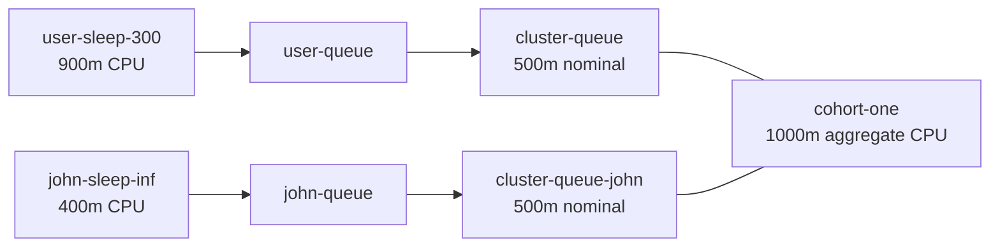

# Kueue Cohort Borrowing and Preemption Lab

This project demonstrates how [Kueue](https://kueue.sigs.k8s.io/) manages
batch workloads across two `ClusterQueue` objects that share a cohort.

The lab shows three behaviors:

1. A workload consumes its ClusterQueue's nominal CPU quota.
2. It bursts above that quota by borrowing unused quota from a cohort peer.
3. The lending queue reclaims its quota and preempts the borrowing workload.

## Architecture



Both ClusterQueues use the same `default-flavor`. The cohort has `1000m` of
aggregate nominal CPU quota: `500m` from each member.

## Files

| File | Purpose |
| --- | --- |
| `cohort.yaml` | Creates the shared cohort. |
| `cluster-queue-setup.yaml` | Creates the flavor, ClusterQueues, LocalQueues, quotas, and reclaim policy. |
| `job-with-sleep-300.yaml` | Submits nine `100m` Pods through `user-queue`, requesting `900m` total. |
| `job-with-sleep-inf.yaml` | Submits four `100m` Pods through `john-queue`, requesting `400m` total. |

Despite its filename, `job-with-sleep-inf.yaml` sleeps for 300 seconds so the
demo eventually completes.

## Prerequisites

- A running Kubernetes cluster with enough capacity for the demo
- Kueue installed with support for the `kueue.x-k8s.io/v1beta2` API
- `kubectl` configured for the target cluster

Check the cluster before starting:

```bash
kubectl get pods -n kueue-system
kubectl api-resources | grep -E 'clusterqueues|localqueues|cohorts|workloads'
```

## Run the Lab

Start from an empty workload state:

```bash
kubectl delete job user-sleep-300 john-sleep-inf \
  -n default --ignore-not-found
```

Create the cohort and queues:

```bash
kubectl apply -f cohort.yaml
kubectl apply -f cluster-queue-setup.yaml
kubectl get cohorts,clusterqueues
kubectl get localqueues -n default
```

### 1. Borrow cohort quota

Submit the user workload:

```bash
kubectl apply -f job-with-sleep-300.yaml
kubectl get jobs,pods,workloads -n default
kubectl describe clusterqueue cluster-queue
```

The nine Pods request `900m` CPU. `cluster-queue` owns `500m`, so the expected
reservation is:

```text
Total:     900m
Borrowed:  400m
```

### 2. Reclaim John's quota

While `user-sleep-300` is still running, submit John's workload:

```bash
kubectl apply -f job-with-sleep-inf.yaml
kubectl get workloads -n default
kubectl get pods -n default
```

John requests `400m`, which fits within `cluster-queue-john`'s own `500m`
nominal quota. Only `100m` is free in the cohort, so John must reclaim quota
from `cluster-queue`. Its `reclaimWithinCohort: Any` policy allows Kueue to
preempt the borrowing workload even though both workloads have the default
priority.

Kueue preempts at Workload granularity. All Pods belonging to
`user-sleep-300` are removed and its Job is suspended and requeued. John's four
Pods can then run. When John finishes and releases quota, Kueue can readmit the
user workload and create new Pods for it.

Inspect the decision:

```bash
kubectl describe workload -n default
kubectl describe clusterqueue cluster-queue
kubectl describe clusterqueue cluster-queue-john
kubectl get events -n default --sort-by=.lastTimestamp
```

## Useful Observations

Kueue quota and Kubernetes node capacity are separate constraints. Kueue may
admit a workload that still has Pending Pods if the node lacks CPU or memory.
Use these commands to distinguish the two cases:

```bash
# Kueue admission and quota
kubectl get workloads -n default
kubectl describe workload -n default

# Kubernetes scheduling
kubectl get pods -n default
kubectl describe pod POD_NAME -n default
kubectl describe node minikube
```

`kubectl get` can show several resource types in one snapshot, but `-w` can
watch only one type at a time:

```bash
kubectl get workloads -n default -w
```

## Cleanup

```bash
kubectl delete job user-sleep-300 john-sleep-inf \
  -n default --ignore-not-found
kubectl delete localqueue user-queue john-queue \
  -n default --ignore-not-found
kubectl delete clusterqueue cluster-queue cluster-queue-john \
  --ignore-not-found
kubectl delete cohort cohort-one --ignore-not-found
kubectl delete resourceflavor default-flavor --ignore-not-found
```

## Production Notes

`reclaimWithinCohort: Any` is intentionally forceful and makes this lab
deterministic. In a shared production environment, workload priorities and
`LowerPriority` are often a better fit because they restrict which workloads
can be preempted. Preempted batch work may restart, so applications should
checkpoint progress when interruption is expensive.

See the Kueue documentation for
[ClusterQueues](https://kueue.sigs.k8s.io/docs/concepts/cluster_queue/),
[cohorts](https://kueue.sigs.k8s.io/docs/concepts/cohort/), and
[preemption](https://kueue.sigs.k8s.io/docs/concepts/preemption/).
